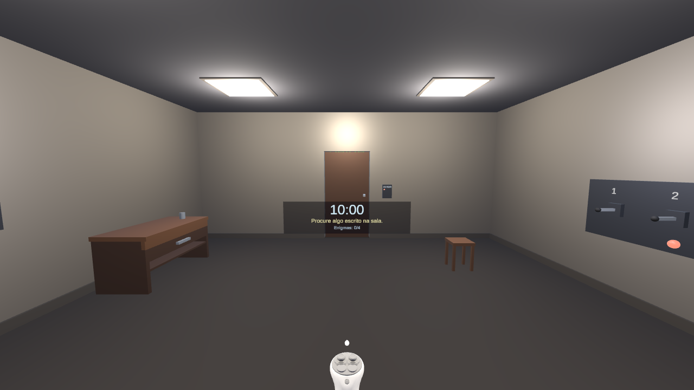
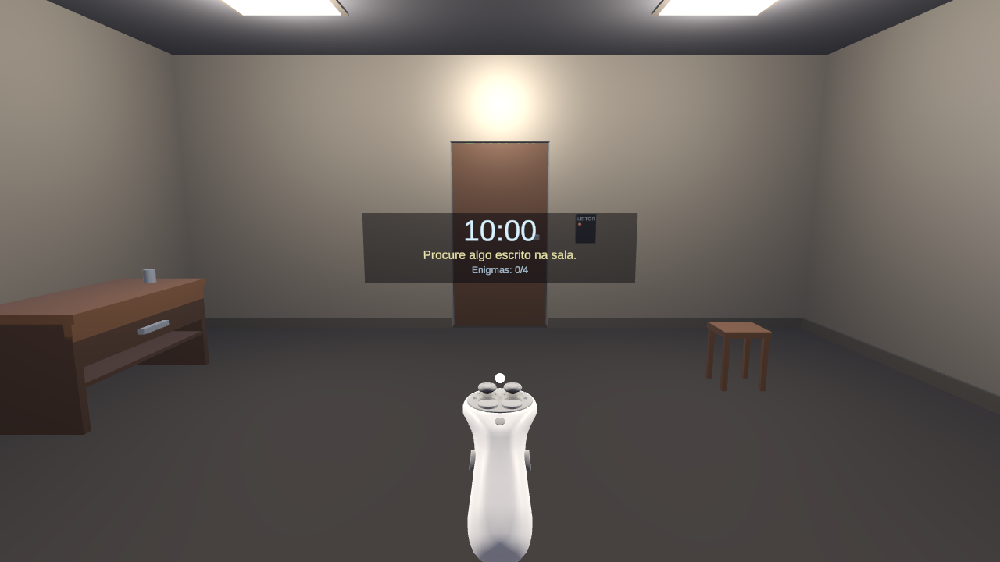
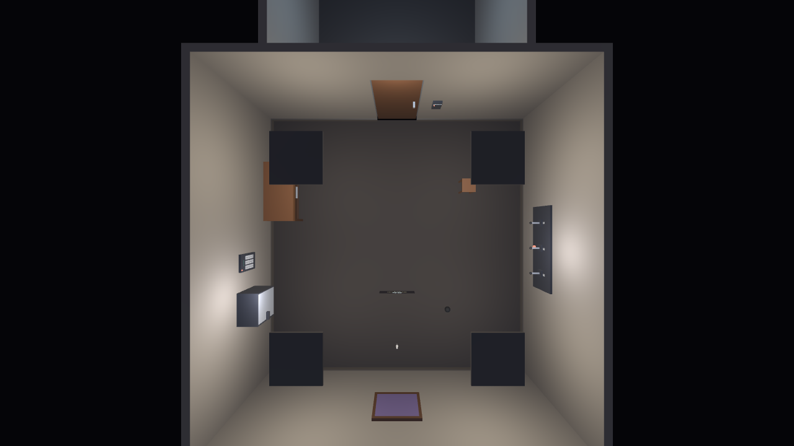
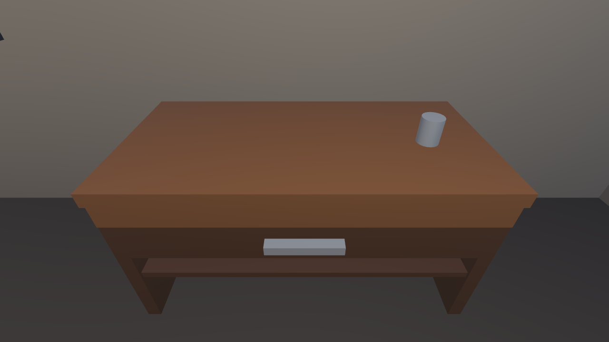
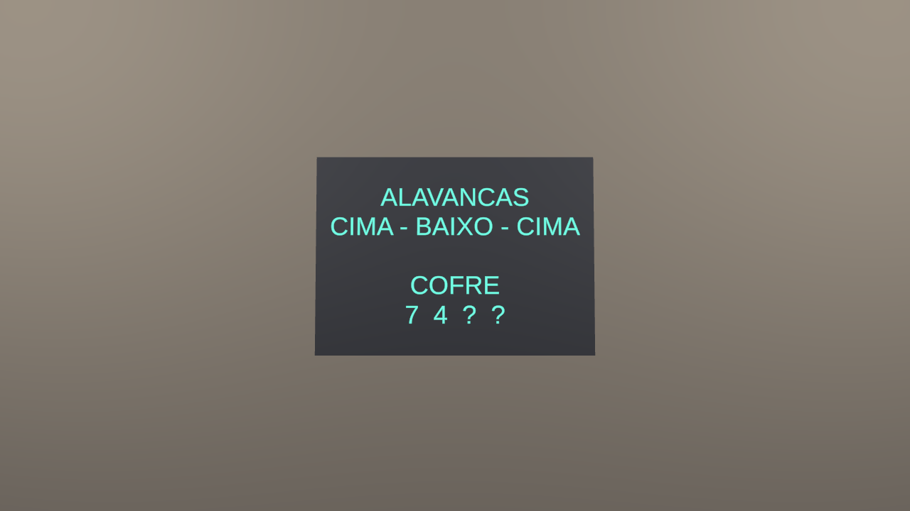
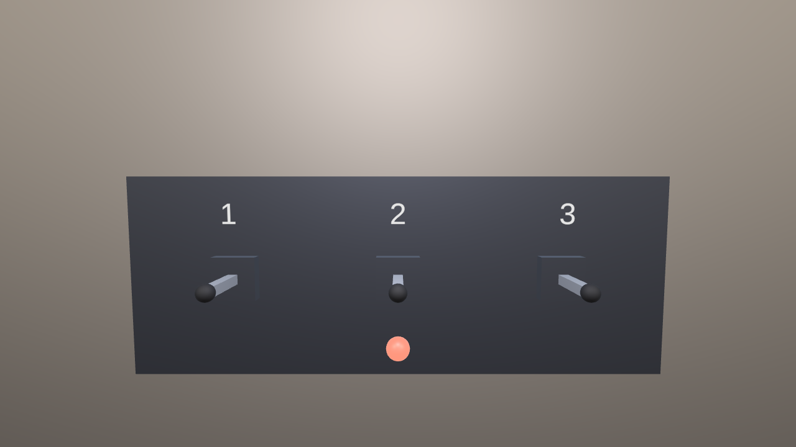
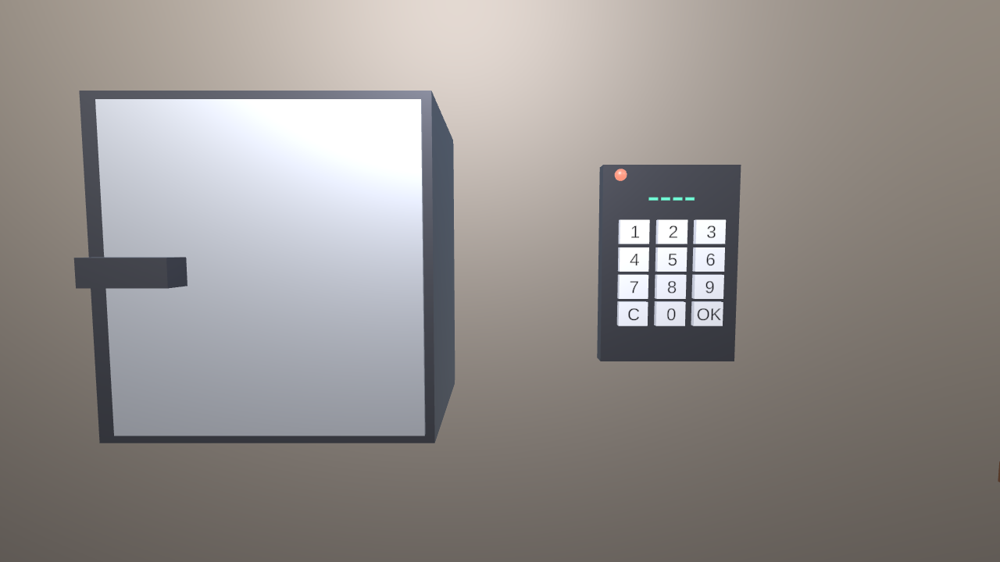
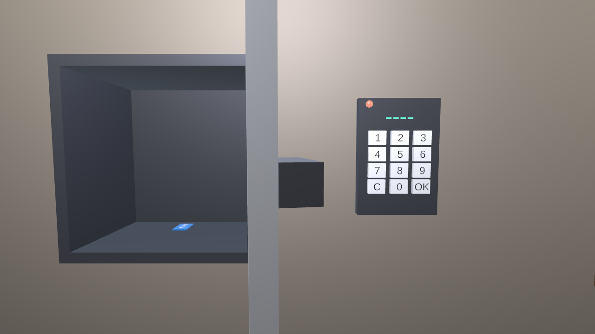
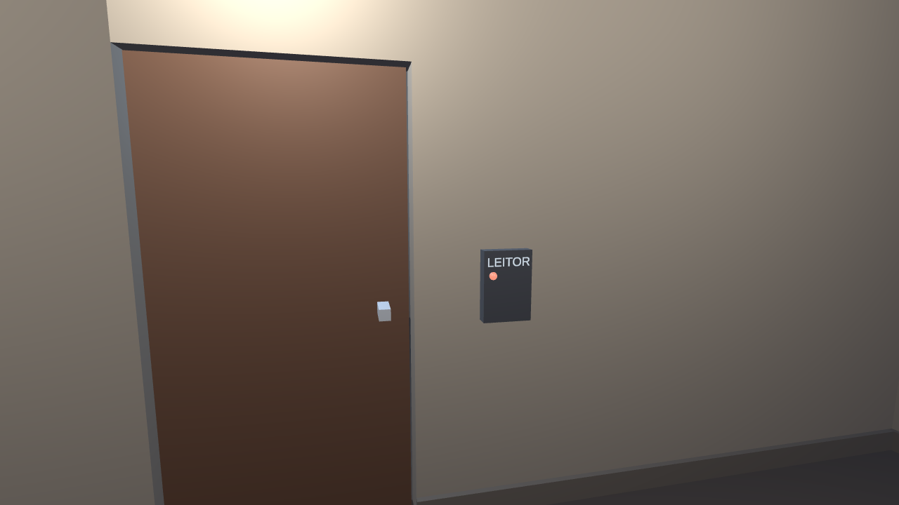
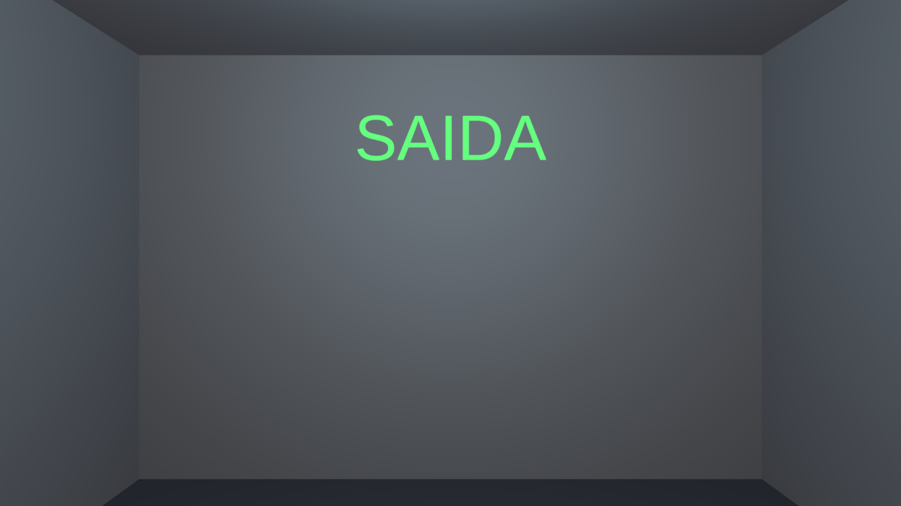

# Escape Room em Realidade Virtual

Projeto da disciplina **CIC904 — Multimídia e Realidade Virtual** (Prof. Isaac).

**Aluno:** Giuliano Rodrigues Tumoli — RA 21.00036-0

▶️ **[Vídeo da demonstração](#vídeo-da-demonstração)** · 🖼️ **[Imagens](#imagens)** · 🔑 **[Solução dos enigmas](#solução-dos-enigmas-para-quem-for-avaliar)**

---

## Descrição do projeto

Um jogo de *escape room* em Realidade Virtual, feito em **Unity 6** para o **Meta Quest**.
O jogador acorda trancado numa sala e tem **10 minutos** para explorá-la, manipular os
objetos e resolver uma sequência de quatro enigmas encadeados até destrancar a porta de
saída e atravessá-la.

Cada enigma só pode ser resolvido com a informação liberada pelo anterior, então a sala
funciona como um quebra-cabeça único em vez de quatro desafios soltos:

| # | Enigma | O que o jogador faz | O que libera |
|---|--------|---------------------|--------------|
| — | *Gaveta da mesa* (dica) | Puxa a gaveta pelo puxador, pega o bilhete e o aproxima do rosto para ler | A dica de que o quadro esconde algo |
| 1 | **Quadro da parede** | Agarra o quadro e o retira da parede | Painel escondido: o padrão das alavancas (`CIMA BAIXO CIMA`) e os dois primeiros dígitos do cofre (`7 4 ? ?`) |
| 2 | **Três alavancas** | Aciona as alavancas até reproduzir o padrão do painel | Luz verde acende e um display revela os dois últimos dígitos (`? ? 2 9`) |
| 3 | **Teclado do cofre** | Digita `7429` no teclado numérico virtual | O cofre destranca e a porta dele abre, revelando o cartão-chave |
| 4 | **Leitor da porta** | Encaixa o cartão-chave na fenda do leitor ao lado da porta | A porta final abre; atravessar o corredor = **vitória** |

O bilhete da gaveta é uma **dica, não uma tranca**: ele aponta para o quadro, mas quem
for direto nele escapa sem nunca abrir a gaveta. Por isso o placar do HUD conta só os
quatro enigmas obrigatórios — contar a dica fazia uma partida vencida terminar marcando
"4/5", como se algo tivesse ficado para trás.

Se o cronômetro chegar a zero antes disso, a partida termina em derrota. Nos dois casos
aparece uma tela de fim com o tempo usado e um botão para jogar de novo.

---

## Principais funcionalidades implementadas

### Interação em VR (XR Interaction Toolkit)
- **Pegar e inspecionar objetos** — objetos agarráveis com as mãos/controles. O bilhete e
  o cartão-chave exibem o texto da pista no HUD quando o jogador os aproxima do rosto,
  imitando o gesto natural de "trazer perto dos olhos para ler".
- **Abrir gaveta** — a gaveta é puxada com a mão e corre num trilho, limitada ao curso
  real, sem sair do lugar nem atravessar o móvel.
- **Abrir portas** — a porta do cofre e a porta final abrem por animação controlada,
  com som de destravamento e indicadores luminosos de estado.
- **Encaixar itens em locais específicos** — o leitor de cartão usa um *socket*. O cartão
  pula para dentro da fenda assim que chega perto, ainda na mão do jogador, para ele ver
  que vai encaixar antes de soltar; o leitor então valida se é o cartão certo (qualquer
  outro objeto é recusado com som de erro).
- **Acionar alavancas** — três alavancas de duas posições, com animação do braço e som
  com variação de tom conforme sobem ou descem.
- **Digitar códigos em teclado virtual** — teclado numérico de 12 teclas (0–9, `C`, `OK`),
  com teclas que afundam ao serem pressionadas, display de dígitos, validação automática
  e feedback de erro.
- **Locomoção** — teletransporte por raio e movimento contínuo, com giro, vindos do
  XR Origin dos *Starter Assets* do XRI.

### Física
- Objetos manipuláveis com física real (massa, gravidade, arremesso): caneca, livros e
  uma bola de borracha.
- O bilhete e o cartão-chave nascem parados no lugar, para não escorregarem para fora da
  gaveta e do cofre antes de o jogador chegar neles — se o cartão cair atrás de um móvel,
  a partida fica impossível de terminar. A partir do momento em que são soltos pela
  primeira vez, passam a ser corpos físicos normais (`BecomesPhysicalOnGrab`).

### Áudio espacial
- **Todos os efeitos sonoros são sintetizados em tempo de execução** por código
  (`ProceduralAudio`), sem nenhum arquivo de áudio no projeto: clique de tecla, bipe de
  alavanca, varredura descendente de erro, arpejos de acerto e de destravamento e o
  tique da contagem regressiva.
- Cada objeto interativo tem o seu próprio `AudioSource` em modo 3D, então o som sempre
  vem da direção de onde a ação aconteceu.

### Feedback visual
- Indicadores luminosos com material emissivo que pulsam em vermelho enquanto travados e
  ficam verdes ao destravar, acompanhados de uma `Light` real.
- Painéis de pista com material emissivo, que acendem quando revelados.

### Progressão, HUD e telas
- `GameManager` central com máquina de estados (parado / jogando / vitória / derrota) e
  um registro de progresso que ignora conclusões repetidas.
- Cronômetro de 10 minutos com estado de alerta no último minuto (cor e tique sonoro).
- HUD em *world space* que acompanha o olhar "com folga" — fica parado enquanto o jogador
  olha para perto dele e só se reposiciona quando o olhar se afasta, evitando o desconforto
  de um painel grudado na câmera.
- HUD mostra cronômetro, próximo objetivo (texto que muda conforme o progresso),
  contador de enigmas e o painel de pistas.
- Telas de vitória e derrota com o tempo usado e botões 3D de **Jogar de novo** e **Sair**.

### Ferramentas de desenvolvimento (scripts de Editor)
O projeto inclui um menu próprio no Editor, em **Escape Room VR**:

| Item | O que faz |
|------|-----------|
| 0. Importar recursos do TextMeshPro | Traz a fonte padrão e o asset de configuração do TMP |
| 1. Instalar pacotes | Resolve as dependências pelo Package Manager |
| 2. Configurar projeto (URP + XR + Quest) | Cria e atribui os assets do URP, converte os materiais dos exemplos, liga o OpenXR e ajusta o build do Quest (IL2CPP, ARM64, Vulkan, API mínima) |
| 3. Gerar cena do Escape Room | Monta a cena inteira do zero por código |
| 4. Gerar screenshots da cena | Renderiza vários pontos de vista para arquivos PNG |
| 5. Gerar screenshots com enigmas revelados | O mesmo, com os painéis escondidos ligados e as portas abertas |
| 6. Diagnosticar a cena | Procura materiais com shader quebrado, renderers sem material e textos sem fonte |
| 7. Listar renderers perto do jogador | Ajuda a identificar objetos estranhos numa captura |
| 8. Converter materiais dos exemplos para URP | Troca shaders do pipeline embutido pelos equivalentes do URP |

### Testes automatizados
Como o desenvolvimento foi feito sem um óculos à mão, a verificação de que o jogo
realmente funciona é feita por testes que **carregam a cena de verdade e resolvem a
cadeia inteira por código**, do bilhete até a tela de vitória.

- `PuzzleLogicTests` (Edit Mode): regras de progressão — concluir a mesma etapa duas
  vezes não conta em dobro, o reset limpa tudo, a cadeia cobre as cinco etapas.
- `EscapeRoomFlowTests` (Play Mode): carrega `EscapeRoom.unity` e verifica que a partida
  começa rodando, que o quadro revela o painel, que as alavancas só resolvem na
  combinação certa, que o teclado recusa código errado e aceita `7429`, que o cofre abre,
  que o cartão no leitor abre a porta final e que atravessar a saída encerra com vitória.
  Dois deles cobrem problemas encontrados jogando: um leva o cartão até a fenda movendo o
  objeto no mundo (em vez de forçar a seleção, que mascarava o tamanho da área de
  encaixe) e outro confirma que bilhete e cartão ganham física depois de soltos.

Rodando pela linha de comando:

```bash
"G:/Unity/6000.3.10f1/Editor/Unity.exe" -batchmode -projectPath . -runTests -testPlatform PlayMode -testResults results.xml -logFile tests.log
```

Resultado atual: **17 testes, 17 aprovados**.

A cena é construída por script (`EscapeRoomSceneBuilder`) e não montada à mão. Assim ela
pode ser regerada do zero quando a planta da sala muda, e todo o posicionamento fica
documentado e versionado em texto em vez de escondido dentro de um arquivo `.unity`.

---

## Tecnologias, linguagens e bibliotecas

| Item | Versão |
|------|--------|
| Unity | **6000.3.10f1** (Unity 6.3) |
| Linguagem | C# |
| Render pipeline | Universal Render Pipeline (URP) **17.3.0** |
| XR Interaction Toolkit | **3.7.0** |
| OpenXR Plugin | **1.19.0** |
| XR Plugin Management | 4.x (dependência do OpenXR) |
| Input System | **1.20.1** |
| uGUI + TextMeshPro | **2.0.0** |
| Plataforma alvo | Android / Meta Quest (ARM64, IL2CPP, Vulkan) |
| Plataforma de teste | Windows + XR Interaction Simulator |

Pacotes de exemplo importados do XR Interaction Toolkit:
- **Starter Assets** — prefab `XR Origin (XR Rig)` já configurado (interatores, locomoção,
  teletransporte) e o asset `XRI Default Input Actions`.
- **XR Interaction Simulator** — permite jogar no PC com teclado e mouse, sem o óculos.

Nenhum asset de arte ou de áudio externo é usado: toda a geometria sai de primitivas,
todos os materiais são gerados por script (`MaterialLibrary`) e todo o áudio é
sintetizado em runtime (`ProceduralAudio`).

---

## Estrutura do projeto

```
Assets/
  _Project/
    Editor/                      Ferramentas de Editor (menu "Escape Room VR")
      PackageSetup.cs            Instala os pacotes do projeto
      ProjectConfigurator.cs     URP, OpenXR, Player Settings do Quest
      MaterialLibrary.cs         Cria os materiais da sala como assets
      SceneBuildUtils.cs         Primitivas, textos 3D e atribuição de campos serializados
      EscapeRoomSceneBuilder.cs  Monta a cena inteira
      SceneScreenshotTool.cs     Renderiza screenshots da cena
    Materials/                   Materiais gerados
    Scenes/
      EscapeRoom.unity           A cena do jogo
    Scripts/
      Core/                      GameManager, GameTimer, PuzzleProgress, estados
      Puzzles/                   Lever, LeverPuzzle, Keypad, KeypadKey, CardReader, KeyCard
      Interaction/               SlidingDrawer, AnimatedDoor, Inspectable, HiddenReveal,
                                 EscapeTrigger, InteractableButton
      Feedback/                  AudioCue, EmissiveIndicator
      UI/                        HudController, EndScreenController, EndScreenButton, LazyFollow
      Utils/                     ProceduralAudio (síntese dos efeitos sonoros)
    Settings/                    Assets do URP e do XR
  Samples/                       Starter Assets e simulador do XR Interaction Toolkit
```

### Arquitetura

O desenho segue uma regra simples: **nenhum enigma conhece outro enigma**.

- Cada enigma é um componente independente que, ao ser resolvido, avisa o `GameManager`
  qual etapa concluiu (`CompleteStep`) e aciona a sua consequência direta por uma
  referência serializada (a porta que ele destranca, os objetos que ele revela).
- O `GameManager` só guarda estado e dispara eventos. Quem reage é o HUD, a tela de fim e
  os indicadores — nenhum deles é consultado de volta.
- O texto do próximo objetivo fica no `HudController`, não no `GameManager`, porque é
  apresentação e não regra de jogo.
- Os componentes de runtime mantêm os campos privados. As ligações feitas pelo construtor
  de cena são aplicadas via `SerializedObject`, exatamente como se tivessem sido
  arrastadas à mão no Inspector.

---

## Como rodar

### Dependências

- **Unity 6000.3.10f1** (instale pelo Unity Hub).
- Módulo **Android Build Support** com **OpenJDK** e **Android SDK & NDK**, se você for
  gerar o APK para o Quest.
- Os pacotes do Package Manager já estão fixados em `Packages/manifest.json` e
  `Packages/packages-lock.json`; o Unity os baixa sozinho na primeira abertura.

### Rodar no PC (sem óculos)

1. Abra o projeto no Unity 6000.3.10f1.
2. Abra a cena `Assets/_Project/Scenes/EscapeRoom.unity`.
3. Entre em **Play**. O **XR Interaction Simulator** já está na cena.

Controles do **XR Interaction Simulator** (teclado e mouse), conforme as bindings padrão
do asset `XR Interaction Simulator Controls`:

| Tecla | Ação |
|-------|------|
| `W` `A` `S` `D` | andar pela sala |
| `Q` / `E` | descer / subir |
| mouse (segurando o botão direito) | olhar em volta |
| botão esquerdo do mouse | apontar e selecionar — é o que pega objetos, aciona alavancas e aperta as teclas do cofre |
| `Tab` | alternar entre modo FPS e modo de manipular dispositivo |
| `[` / `]` | manipular a mão esquerda / direita (apertar duas vezes alterna entre controle e mão) |
| `H` | manipular a cabeça |
| `Space` | executar a ação rápida selecionada |
| `` ` `` | trocar a ação rápida (gatilho, grip, botões) |
| `R` | reposicionar o dispositivo manipulado |
| `X` / `Y` | abrir os menus de ação e de seleção de entrada do simulador |

> O simulador mostra os atalhos mais usados numa janelinha durante o Play. Se preferir
> outras teclas, dá para editar os três `.inputactions` em
> `Assets/Samples/XR Interaction Toolkit/3.7.0/XR Interaction Simulator`.

### Rodar no Meta Quest

> **Pré-requisito:** o Editor precisa do módulo **Android Build Support** (com OpenJDK e
> Android SDK & NDK Tools), instalado pelo Unity Hub em *Add modules*. Sem ele o Unity
> não gera o APK e nem deixa configurar o XR para Android — o menu
> **2. Configurar projeto** avisa no console quando esse é o caso.

1. No celular, abra o app **Meta Horizon** e ative o **modo desenvolvedor** na conta.
   Autorize também no próprio óculos.
2. Ligue o Quest ao PC pelo cabo USB e aceite a depuração USB dentro do óculos.
3. No Unity, rode o menu **Escape Room VR → 2. Configurar projeto (URP + XR + Quest)**.
   Ele já deixa o OpenXR ligado para Android, os perfis de controle do Quest habilitados
   e o Player Settings ajustado (IL2CPP, ARM64, Vulkan, API 32+).
4. Em **File → Build Profiles**, selecione **Android** e clique em **Switch Profile**.
5. Clique em **Build And Run**.

Para conferir a configuração à mão, em **Project Settings → XR Plug-in Management →
Android** o **OpenXR** deve estar marcado e, em **OpenXR**, o perfil
**Oculus Touch Controller Profile** (ou **Meta Quest Touch Plus**) deve estar na lista de
*Interaction Profiles*.

### Regerar a cena do zero

Se quiser reconstruir a sala (por exemplo depois de mudar medidas no
`EscapeRoomSceneBuilder`), use o menu **Escape Room VR → 3. Gerar cena do Escape Room**.
Isso **sobrescreve** `Assets/_Project/Scenes/EscapeRoom.unity`.

> Cada regeração renumera os `fileID` de todos os objetos, então o `git diff` da cena
> fica enorme mesmo quando nada mudou de verdade. Se a regeração foi só para conferir
> algo, vale descartar o arquivo (`git checkout -- <cena>`) em vez de commitar milhares
> de linhas sem conteúdo.

---

## Vídeo da demonstração

Uma partida completa, da sala trancada até a tela de vitória, gravada no PC com o
**XR Interaction Simulator** no lugar do óculos — 1920x1080, 30 fps, 1 minuto.

[](https://github.com/giuliano-rt/escape-room-vr/raw/main/docs/video/demo-escape-room-vr.mp4)

▶️ **[Assistir / baixar o vídeo (46 MB)](https://github.com/giuliano-rt/escape-room-vr/raw/main/docs/video/demo-escape-room-vr.mp4)**

> O GitHub não reproduz arquivos `.mp4` versionados dentro da página do README — o link
> acima abre o arquivo direto. Ele está versionado em
> [`docs/video/demo-escape-room-vr.mp4`](docs/video/demo-escape-room-vr.mp4).

---

## Imagens

Todas as capturas abaixo foram geradas pela ferramenta de screenshots do próprio projeto
(**Escape Room VR → 4** e **→ 5**), renderizando a cena de pontos de vista fixos.

### A sala

| | |
|---|---|
|  |  |
| Visão geral a partir do ponto onde o jogador começa | O HUD acompanha o olhar: cronômetro, objetivo atual e enigmas resolvidos |



*Planta da sala vista de cima, com o teto escondido: mesa e cofre na parede oeste,
alavancas na leste, quadro na sul e a porta de saída na norte.*

### Os quatro enigmas

| | |
|---|---|
|  |  |
| *Dica.* A gaveta da mesa é puxada com a mão e guarda o bilhete | **1.** Atrás do quadro: o padrão das alavancas e os dois primeiros dígitos |
|  |  |
| **2.** As três alavancas, com o indicador de estado abaixo delas | **3.** O cofre e o teclado numérico de 12 teclas |
|  |  |
| O cofre aberto, com o cartão-chave dentro | **4.** A porta de saída e o leitor onde o cartão é encaixado |



*O corredor depois da porta. Atravessá-lo é o que encerra a partida com vitória.*

---

## Solução dos enigmas (para quem for avaliar)

<details>
<summary>Spoiler</summary>

1. A gaveta da mesa, na parede oeste, abre livremente. Dentro dela há um bilhete:
   *"O quadro esconde o padrão"*.
2. O quadro está na parede sul. Agarre-o e retire-o: atrás há um painel com
   `ALAVANCAS: CIMA BAIXO CIMA` e `COFRE: 7 4 ? ?`.
3. As três alavancas estão na parede leste, numeradas de 1 a 3. Deixe a 1 e a 3 para
   cima e a 2 para baixo. A luz fica verde e o display acima mostra `COFRE: ? ? 2 9`.
4. O código completo é **7429**. Digite no teclado ao lado do cofre (parede oeste).
   O cofre abre e dentro há o cartão-chave.
5. Pegue o cartão e encaixe na fenda do leitor, à direita da porta de saída
   (parede norte). A porta abre; atravesse o corredor para ganhar.

</details>
